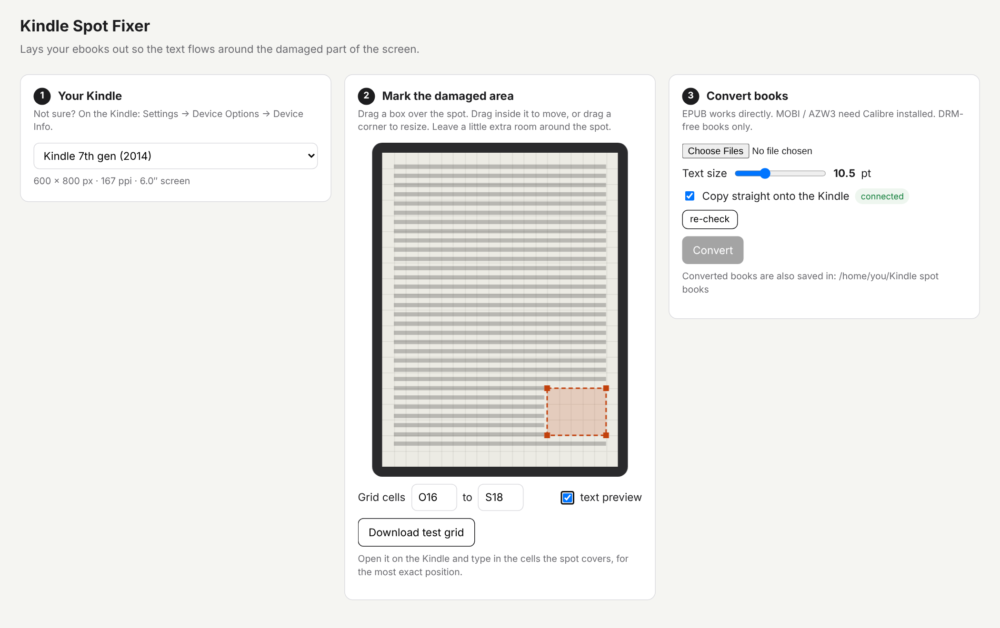
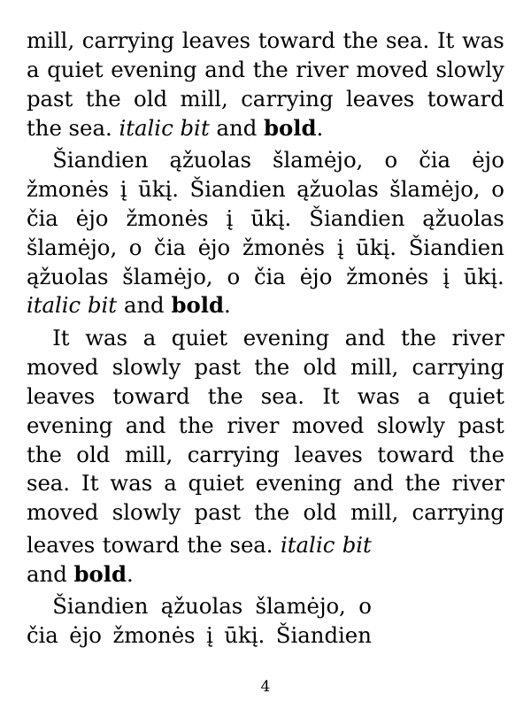

# Kindle Spot Fixer

Got a Kindle with a dead spot or pressure mark on the screen? This tool lays your ebooks out so the text **flows around the damaged area**, so you can keep reading on an old Kindle instead of throwing it away.



## How it works

Normal Kindle books are reflowable: the Kindle decides where each line goes, so you can't keep text away from one fixed spot. This app instead renders the book into pages sized exactly to your Kindle's screen, with a blank area where the damage is. The result is a PDF that you copy to the Kindle.



## Features

- **Three-step app** that opens in your browser and works fully offline
  1. Pick your Kindle model (most models from 2012 to 2024)
  2. Drag a box over the damaged area. You can move and resize it, with a live text preview
  3. Pick your books and convert them
- **Test grid PDF** to find the exact position of the spot on your actual device
- **Copies the books straight onto the Kindle** when it's plugged in by USB
- Converts several books at once, and remembers your settings
- Supports Lithuanian and other accented Latin characters (ą č ę ė į š ų ū ž …)

## Installation

1. Install [Python 3](https://www.python.org/downloads/). On Windows, tick **"Add Python to PATH"**.
2. Download this repository (**Code → Download ZIP**) and unzip it.
3. Install the libraries it needs:
   ```
   pip install -r requirements.txt
   ```
4. *(Optional)* Install [Calibre](https://calibre-ebook.com) if you want to convert MOBI or AZW3 files. EPUB files work without it.

## Usage

**Windows:** double-click `Start Kindle Spot Fixer.bat`

**Mac / Linux / Windows terminal:**
```
python kindle_spot.py
```

The app opens in your browser. Keep the terminal window open while you use it, and press `Ctrl+C` to quit.

**Tip:** click **Download test grid**, open the PDF on your Kindle, and note which cells the spot covers (for example `O16` to `S18`). Type those cells into the app to get the most accurate placement.

**Quick convert** using your last saved settings, without opening the app:
```
python kindle_spot.py book1.epub book2.epub
```

Converted books are saved in a `Kindle spot books` folder in your home directory.

## Limitations

- **DRM-free books only.** Books bought from the Kindle Store are locked and can't be converted.
- The text size is fixed when you convert. To change it, convert the book again.
- Images and complex formatting (tables, special layouts) are dropped. It works best for novels and other mostly-text books.

## Supported models

Kindle 4 / 5 / Touch, Kindle 7th, 8th, 10th and 11th gen, Paperwhite 1 to 5 and 12th gen, Voyage, Oasis 2 / 3.

## License

[MIT](LICENSE)
